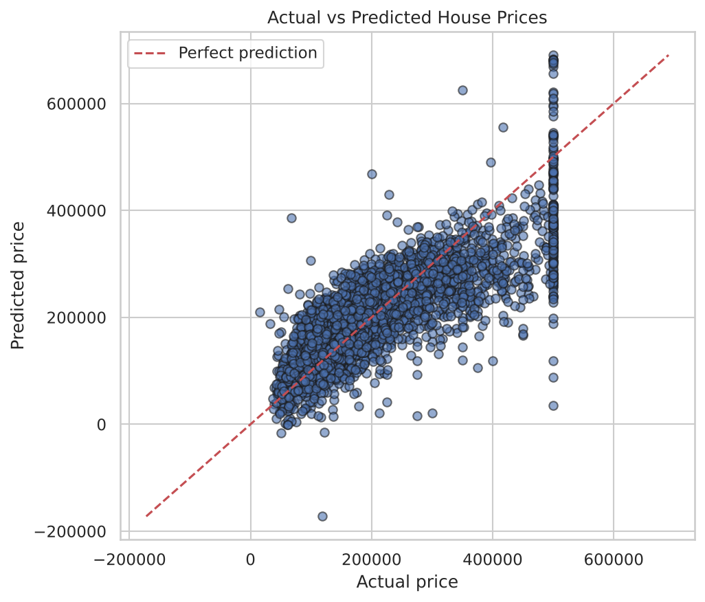
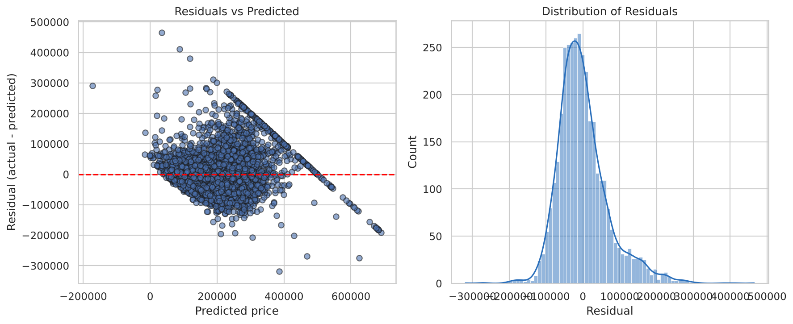
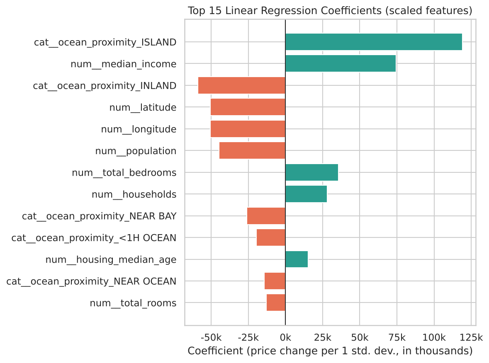
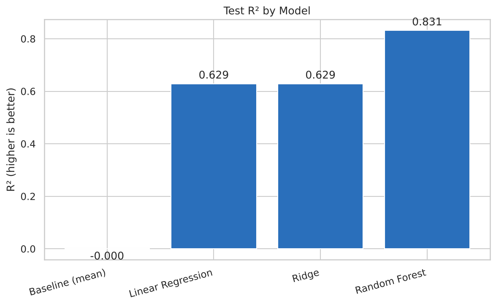

# House Price Prediction Using Linear Regression

A machine learning project that predicts house prices with **Linear Regression** in Python (scikit-learn). It covers the full workflow: data loading and cleaning, a leak-free preprocessing pipeline, model comparison, evaluation, residual analysis, and a saved model you can use on new houses.

## Project Goal

Predict a house's median value from its features (location, age, rooms, income, distance to the ocean) and measure how reliable those predictions are.

## Dataset

- **Data:** California housing data (1990 census block groups), file `house_price.csv`
- **Size:** 17,929 rows, 10 columns (9 features + the target)
- **Target:** `median_house_value`
- **Features:** `longitude`, `latitude`, `housing_median_age`, `total_rooms`, `total_bedrooms`, `population`, `households`, `median_income`, `ocean_proximity` (categorical)
- **Missing values:** 171 in `total_bedrooms`, filled with the median inside the pipeline

Put your CSV in the project folder as `house_price.csv`, or pass a different file with `--input`.

## Project Structure

```
├── house_price_prediction.py   # Train, compare, evaluate and save the model
├── predict.py                  # Predict prices for new houses
├── house_price.csv             # Dataset
├── requirements.txt
├── output/                     # Created when you run the script
│   ├── house_price_model.joblib
│   ├── metrics.json
│   ├── model_comparison.csv
│   └── *.png                   # Plots
└── README.md
```

## Method

1. **Load and validate** the data: checks the target column, removes duplicates and rows with a missing price.
2. **Preprocess inside a Pipeline** (so nothing leaks from the test set):
   - Numeric columns: fill missing values with the median, then standardise.
   - Categorical columns: fill with the most frequent value, then one-hot encode.
3. **Split** into 80% training and 20% testing (fixed random seed).
4. **Compare models** with 5-fold cross-validation and a final test score: a mean-price baseline, Linear Regression, Ridge and Random Forest.
5. **Evaluate** the Linear Regression model with MAE, RMSE and R².
6. **Check the model's assumptions** with residual plots, and inspect the largest coefficients.
7. **Save** the trained pipeline, metrics and plots.

## Getting Started

```bash
git clone https://github.com/niks175/House_Price_Prediction_Using_Python.git
cd House_Price_Prediction_Using_Python
pip install -r requirements.txt
python house_price_prediction.py
```

Options:

```bash
python house_price_prediction.py --input house_price.csv --target median_house_value
python house_price_prediction.py --log-target    # train on log(price); in this dataset it did not help
python house_price_prediction.py --test-size 0.3 --seed 7
```

### Predict prices for new houses

Create a CSV with the same feature columns as the training data (no `median_house_value` column), then run:

```bash
python predict.py --input new_houses.csv --output predictions.csv
```

## Results

Evaluated on a held-out 20% test set (3,586 houses). Prices are in US dollars.

| Model | CV R² | Test MAE | Test RMSE | Test R² |
|---|---|---|---|---|
| Baseline (mean price) | -0.000 | $90,327 | $114,538 | -0.000 |
| **Linear Regression** | **0.624** | **$51,197** | **$69,775** | **0.629** |
| Ridge | 0.624 | $51,206 | $69,784 | 0.629 |
| Random Forest | 0.813 | $30,749 | $47,033 | 0.831 |

**How to read the metrics**
- **MAE:** the average size of the error, in price units.
- **RMSE:** like MAE but punishes large errors more.
- **R²:** the share of price variation the model explains (1.0 is perfect; 0 is no better than guessing the average).

## Visualizations

| | |
|---|---|
|  |  |
|  |  |
## Key Insights

- **Linear Regression beats the baseline clearly.** It explains about 63% of the variation in house values and cuts the average error from about $90,000 to about $51,000 (a 43% reduction).
- **Income matters most.** `median_income` is the strongest numeric driver: it has a 0.67 correlation with house value, and one standard deviation more income adds about $74,000 to the predicted value.
- **Ridge gives the same result as Linear Regression**, so regularisation brings no benefit here and overfitting is not the problem.
- **A non-linear model fits much better.** Random Forest reaches R² 0.83 and halves the error to about $31,000. Prices depend on location (latitude, longitude, coast) in a curved, non-linear way that a straight-line model cannot capture.
- **The residual plot shows a limit in the data.** 834 houses (4.7%) are capped at $500,001, which creates the diagonal line of errors, and the linear model sometimes predicts negative prices for cheap areas.

## Limitations

- Linear Regression assumes a straight-line relationship between features and price, and can miss complex patterns.
- Results come from one dataset; prices in other cities or years may behave differently.
- The target is capped at $500,001, so very expensive areas are under-predicted.
- Only 5 houses are on an `ISLAND`, so that coefficient is unreliable.
- Outliers and strongly correlated features (such as rooms, bedrooms and households) can distort coefficients.

## Tech Stack

Python, pandas, NumPy, scikit-learn, Matplotlib, Seaborn, joblib

## Contributing

Suggestions and improvements are welcome. Open an issue or submit a pull request.
